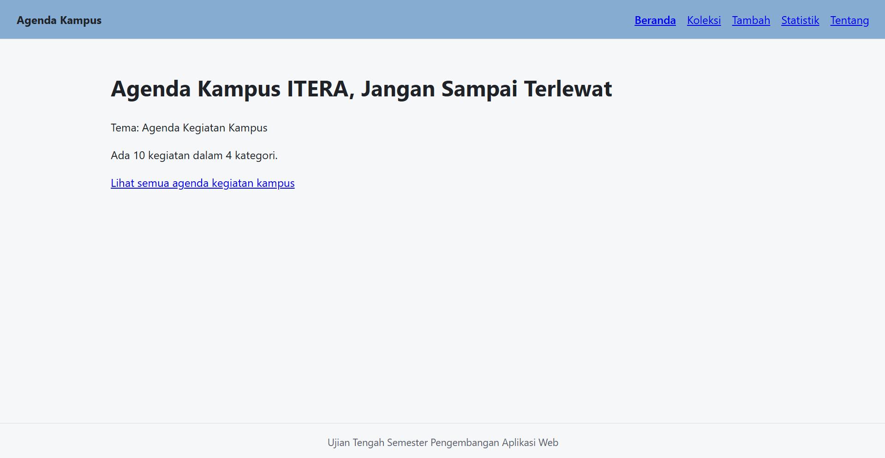
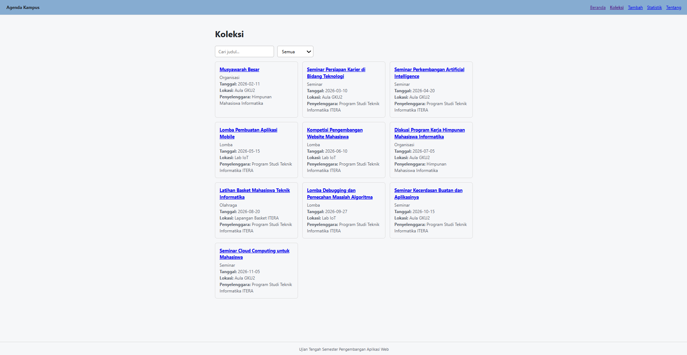
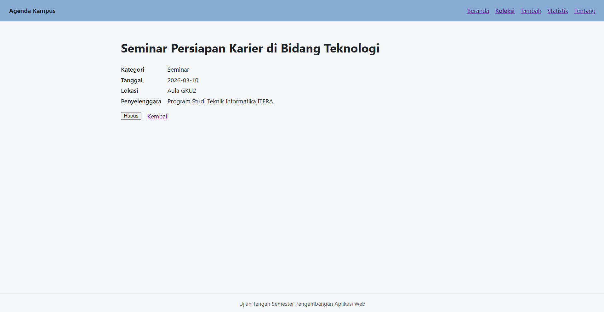
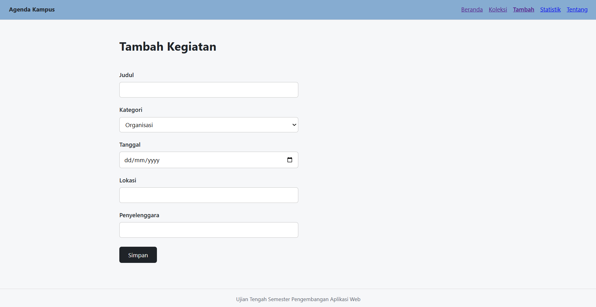
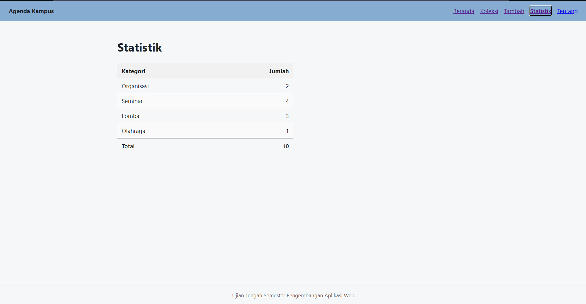
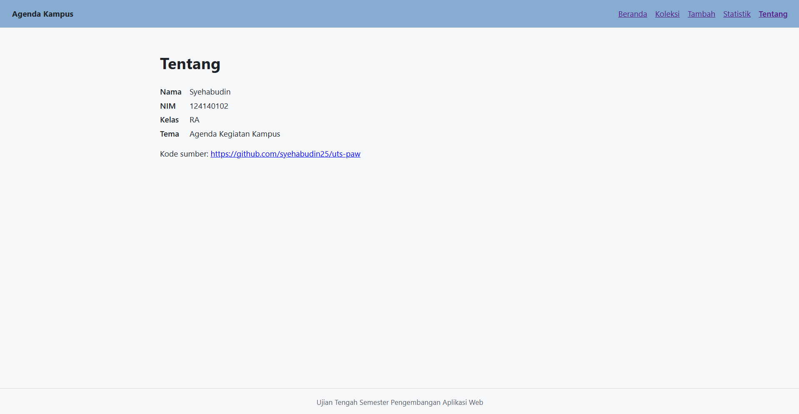

# Ujian Tengah Semester IF25-22014 Pengembangan Aplikasi Web

# Agenda Kegiatan Kampus

- **Nama:** Syehabudin
- **NIM:** 124140102
- **Kelas:** RA
- **Tema:** Agenda Kegiatan Kampus
- **Deployment:** https://syehabudin25.github.io/uts-paw/

## Tangkapan Layar Aplikasi

**Halaman Beranda**

*Gambar 1. Halaman Beranda*

**Halaman Koleksi**

*Gambar 2. Halaman Koleksi Kegiatan*

**Halaman Detail Kegiatan**

*Gambar 3. Halaman Detail Kegiatan*

**Halaman Tambah Kegiatan**

*Gambar 4. Halaman Form Tambah Kegiatan*

**Halaman Statistik**

*Gambar 5. Halaman Statistik Kegiatan*

**Halaman Tentang**

*Gambar 6. Halaman Tentang Aplikasi*

## Fitur

- Menampilkan ringkasan jumlah kegiatan dan kategori pada halaman beranda.
- Menampilkan daftar agenda kegiatan kampus dalam bentuk kartu.
- Pencarian kegiatan berdasarkan judul dan filter berdasarkan kategori.
- Melihat informasi lengkap kegiatan (kategori, tanggal, lokasi, penyelenggara) pada halaman detail.
- Menambahkan kegiatan baru lewat form dengan validasi judul.
- Menghapus kegiatan dari halaman detail.
- Menampilkan statistik jumlah kegiatan per kategori dalam bentuk tabel.
- Menampilkan identitas mahasiswa, tema, dan tautan repositori GitHub di halaman Tentang.

## Menjalankan secara lokal

cd app
npm install
npm run dev

## Konsep React yang dipakai

- Components & Props: Memecah antarmuka menjadi komponen yang dapat dipakai ulang (Layout, KartuItem, InfoKegiatan, KotakPencarian).
- State & Effect (useState, useEffect): Mengelola state form, pencarian, filter, serta status loading dan error saat memuat data.
- React Context (useContext & custom hook useKoleksi, useLocalStorage): Membagikan data kegiatan ke semua halaman dan menyimpannya di localStorage.
- React Router (react-router-dom): Navigasi multi-halaman (SPA) dengan useNavigate, useParams, NavLink, dan Link.
- Fetch dengan async/await: Memuat data awal dari berkas JSON, lalu menyimpannya di localStorage.
- Pengujian (Vitest + Testing Library): 5 test untuk halaman 404, Koleksi, Tambah, Statistik, dan Tentang.
- Struktur semantik dan CSS responsif: header, nav, main, footer, tata letak flex/grid, dan @media.
- JavaScript modern: destructuring, spread, template literal, map, filter, dan reduce.
